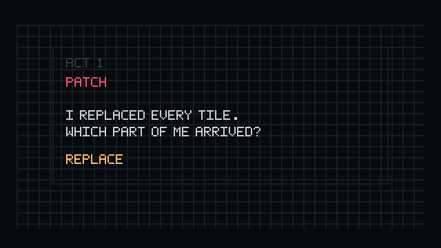
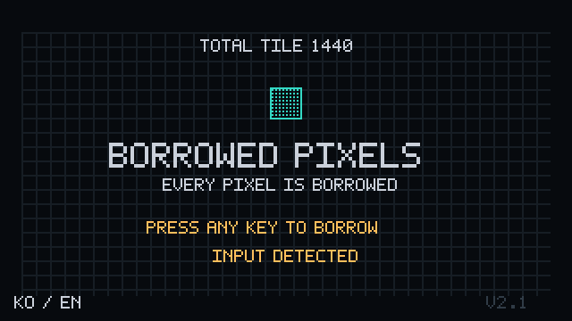
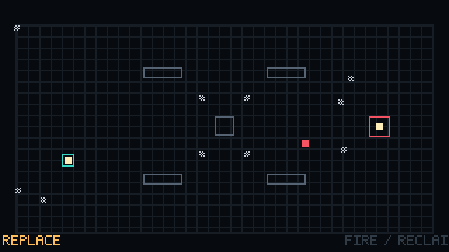
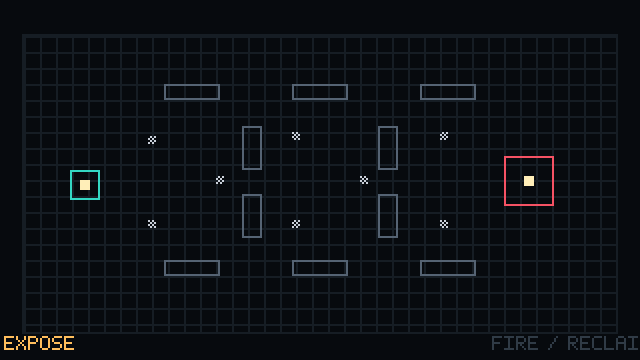

# BORROWED PIXELS

**게임 엔진 없이 C++20과 Win32 API만으로 만든 2D 액션 게임**입니다. 1.44MB 게임개발 공모전(2026.08~09)에 1인으로 출품했습니다.
세계에는 정확히 1,440개의 TILE만 존재하고, 플레이어는 빌린 몸으로 싸우며 타인의 몫을 재배분합니다. 그 선택은 마지막에 세계의 규칙으로 돌아옵니다.

<p align="center">
  
</p>

| 제목 → 전역 원장 | 정산: 3지선다 | Act 1 세 번째 만남 |
|---|---|---|
|  |  |  |

> 위 GIF는 실제 게임 로직과 렌더러(`src/`)를 창 없이 구동한 프레임입니다. Win32 창·입력 계층(`bp_win32.cpp`) 대신 [`tools/portfolio/headless_capture.cpp`](tools/portfolio/headless_capture.cpp)가 같은 `Tick*/Render*` 함수를 60Hz로 호출하고, 입력은 상대를 조준해 일정 간격으로 쏘는 스크립트 봇이 넣습니다. 같은 명령으로 다시 만들면 바이트 단위로 같은 GIF가 나옵니다.

## 숫자로 보는 프로젝트

| 항목 | 값 | 근거 |
|---|---|---|
| 공모전 용량 제한 | 1,474,560 B (1.44MB 플로피) | [제작 명세](docs/authority/BORROWED_PIXELS_FINAL_PRODUCTION_SPEC_v2.1.md) |
| 제출 실행 파일 / 배포 폴더 | **290,304 B / 292,810 B** (제한의 약 20%) | [`docs/evidence/T14/dist-bytes.txt`](docs/evidence/T14/dist-bytes.txt) |
| 외부 에셋 | 0개 (이미지·폰트·음원·엔진·서드파티 런타임 없음) | [`docs/PROVENANCE.md`](docs/PROVENANCE.md) |
| 런타임 코드 / 테스트 코드 | C++ 15,531줄 / 6,733줄 | `wc -l src/* tests/*` |
| 자동 검증 | 13개 스위트, 실행 시 약 800만 회 검사 | [`docs/evidence/T14/test-results.txt`](docs/evidence/T14/test-results.txt) |
| 콘텐츠 | 3개 Act, 10개 만남, 9회 3지선다, 5개 엔딩, 81개 정책 프로필 | `src/bp_act*.cpp`, `src/bp_precedent.cpp` |

## 기술적으로 설명할 수 있는 것

### 1. 용량 제한 안에 게임 전체 넣기
- 이미지, 폰트, 음원 파일을 하나도 쓰지 않습니다. 글자는 코드로 그리고, 소리는 실행 중에 합성합니다.
- 공모전 빌드는 `/O1 /GL /Gy /Gw /GR-`와 `/LTCG /OPT:REF /OPT:ICF /BREPRO`, 정적 CRT로 링크합니다([`CMakeLists.txt`](CMakeLists.txt)). `/BREPRO`로 같은 소스에서 같은 바이트의 실행 파일이 나와 SHA-256으로 제출본을 대조할 수 있습니다.
- XInput은 `LoadLibraryW`로 지연 로드해 실행 파일의 import가 KERNEL32·USER32·GDI32·WINMM 네 개뿐입니다([`docs/evidence/T14/dependencies.txt`](docs/evidence/T14/dependencies.txt)).
- [`tools/measure_dist.ps1`](tools/measure_dist.ps1)이 내부 상한 1,350,000 B와 공모전 상한을 매 빌드마다 검사합니다. 실행 파일은 T01 126,464 B에서 T14 290,304 B까지 단계별로 기록했습니다.

### 2. 한글 11,172자를 코드로 조합하는 비트맵 폰트
유니코드 한글 음절을 초성·중성·종성으로 분해하고, 모음 모양에 따라 8×12 셀 안의 배치 상자를 바꿉니다([`src/bp_font.cpp#L289-L321`](src/bp_font.cpp#L289-L321)).
```cpp
const std::uint32_t syllable = codepoint - 0xAC00u;
const std::uint8_t initial = static_cast<std::uint8_t>(syllable / 588u);
const std::uint8_t vowel = static_cast<std::uint8_t>((syllable % 588u) / 28u);
const std::uint8_t final = static_cast<std::uint8_t>(syllable % 28u);
```
테스트가 11,172자 전체를 그려 셀 밖으로 넘치는 픽셀이 0개인지 확인합니다(`T03_PASS ... hangul_syllables=11172`).

### 3. 항상 합이 1,440인 두 개의 원장
TILE의 물리적 위치(12개 계정)와 소유권(12명)을 각각 `uint16_t[12]` 원장으로 관리합니다. 모든 이동은 **복사본에 적용 → 불변식 검사 → 통과할 때만 커밋**합니다.
```cpp
// src/bp_physical_ledger.cpp#L95-L101
PhysicalLedger candidate = ledger;
candidate.mass[fromIndex] = static_cast<std::uint16_t>(candidate.mass[fromIndex] - amount);
candidate.mass[toIndex] = static_cast<std::uint16_t>(destination);
if (!PhysicalLedgerValid(candidate)) {
    return false;
}
ledger = candidate;
```
전투 충돌과 정산도 같은 방식이라 중간에 실패해도 반쯤 바뀐 상태가 남지 않습니다. 9번의 3지선다가 만드는 3^9 = 19,683가지 조합을 모두 돌려 매 단계 합계를 검사합니다([`tests/bp_ledger_save_tests.cpp`](tests/bp_ledger_save_tests.cpp)).

### 4. 결정론적 60Hz 고정 스텝
- 게임 루프는 QPC 정수 누산기로 1/60초 틱을 계산하고, 한 프레임에 최대 5틱까지만 따라잡습니다. 창이 포커스를 잃으면 누산기를 비웁니다([`src/bp_win32.cpp`](src/bp_win32.cpp), `kMaxCatchUpTicks`).
- 게임 로직에는 부동소수점이 없습니다. 위치는 Q8 고정소수점이고, 원·사각형 연속 충돌은 int64 이차식과 정수 제곱근으로 풉니다([`src/bp_math.h`](src/bp_math.h), [`src/bp_combat.cpp`](src/bp_combat.cpp)).
- 4,096틱 리플레이의 상태 해시가 고정값 `0x61646592`와 일치해야 테스트가 통과합니다.

### 5. 플랫폼 계층 격리
`<windows.h>`를 포함하는 파일은 `bp_win32.cpp` 하나뿐이고, 나머지는 `<cstdint>`, `<cstddef>`, `<cstring>`만 씁니다. 그래서 게임 로직 전체를 창 없이 테스트하고, 위 GIF처럼 다른 하네스에서도 그대로 구동할 수 있습니다.

### 6. 오디오 합성과 원자적 저장
- 48kHz 스테레오, 8보이스의 삼각파·펄스·노이즈 합성기를 `waveOut` 버퍼 4개로 재생합니다. 배경음 레이어 음량은 원장의 TILE 비율을 따라갑니다([`src/bp_audio.cpp`](src/bp_audio.cpp)).
- 저장 파일은 96바이트 고정 형식에 FNV-1a 체크섬을 붙이고, 임시 파일을 `FILE_FLAG_WRITE_THROUGH`로 쓴 뒤 `ReplaceFileW`로 교체해 저장 중 종료돼도 기존 파일이 깨지지 않습니다([`src/bp_save.cpp`](src/bp_save.cpp), `bp_win32.cpp`).

## 검증

- **원 개발 환경:** Windows x64, MSVC. 빌드·자동 테스트·배포 폴더 검증과 실제 창 실행 캡처를 [`tools/verify_rc.ps1`](tools/verify_rc.ps1)로 수행했습니다([`docs/evidence/T14/`](docs/evidence/T14/)).
- **독립 재현 (2026-10-13):** 포트폴리오를 정리하며 Linux의 GCC 13.3에서 `src/`(Win32 계층 제외)와 `tests/`를 다시 빌드해 13개 스위트를 실행했습니다. 결과는 [`docs/evidence/portfolio/gcc-linux-test-results.txt`](docs/evidence/portfolio/gcc-linux-test-results.txt)에 있으며, 모두 PASS였고 리플레이 해시도 MSVC 기록과 같은 `0x61646592`였습니다. 컴파일러가 바뀌어도 시뮬레이션 결과가 같다는 뜻입니다. 테스트 파일 하나가 MSVC 전용 CRT 함수(`fopen_s`, `_dupenv_s`)를 써서 이때만 작은 호환 헤더를 붙였습니다.
- **아직 하지 않은 것:** 사람이 직접 하는 손맛·밸런스 평가와 다른 PC 세 대에서의 실행 확인은 보류 상태입니다([`docs/STATUS.md`](docs/STATUS.md)). 난이도 조정은 하지 않았습니다(`tuning=NONE`). 위 GIF에도 보이듯 정산 화면의 문구가 겹치고 하단 `FIRE / RECLAIM` 안내가 잘리는 UI 문제가 남아 있습니다.

## 개발 방식과 제 역할

혼자 만든 프로젝트이며, **구현의 대부분은 AI 코딩 에이전트(Codex)가 작성했습니다.** 저는 무엇을 만들지와 무엇을 통과로 볼지를 정하고, 결과를 검증·통합하는 역할을 맡았습니다.

- **명세와 계약:** 2,834줄 제작 명세, 런타임 계약 JSON, 글리프 정의, UI 기준 화면을 먼저 확정했습니다([`docs/authority/`](docs/authority/)). 명세 변경은 별도 문서로만 승인했습니다(예: T03 UI 플랫폼 변경, T07 용량 예산 재승인).
- **작업 분할:** 플랫폼, 원장·저장, 렌더링·폰트, 입력·수학, 전투, 회수·HUD, Act 1~3, 정책, 오디오, 현지화를 T00~T14 티켓으로 나누고 티켓마다 수정 가능한 파일과 검증 조건을 정했습니다([`docs/OWNERSHIP.md`](docs/OWNERSHIP.md), [`docs/handoffs/`](docs/handoffs/)).
- **검증 절차:** 각 티켓은 구현 → 별도 세션의 독립 리뷰(P0/P1/P2 등급) → 수정 → 전체 회귀 테스트 → 통합 순서로 진행했고, 생성된 코드를 그대로 받지 않고 MSVC 빌드, 실행, 규칙 검증, 용량 측정을 거쳤습니다.
- 크레딧에도 `AI-assisted design and implementation; human-directed and reviewed`로 표기했습니다.

## 개발 환경

- Windows 10/11 x64
- Visual Studio 2022 또는 Build Tools 2022: C++ 데스크톱 개발 도구와 Windows SDK
- CMake 3.25 이상
- PowerShell

빌드 프리셋은 `Visual Studio 17 2022`의 x64 구성을 사용합니다. Windows 및 MSVC 이외의 환경은 현재 지원하지 않습니다.

## 빌드와 테스트

저장소 루트에서 실행합니다.

```powershell
# 프로젝트 구성
cmake --preset windows-msvc

# 테스트 빌드 및 실행
cmake --build --preset test
ctest --preset all --output-on-failure

# 개발용 실행 파일
cmake --build --preset debug
.\build\windows-msvc\bin\DEBUG\bp_debug.exe

# 공모전용 실행 파일
cmake --build --preset contest
.\dist\contest\BorrowedPixels.exe
```

빌드 결과와 실행 파일은 Git 추적에서 제외됩니다. 저장소를 새로 복제한 경우 위 명령으로 실행 파일을 생성하세요.

기준 문서와 배포 폴더는 다음 명령으로 검증할 수 있습니다. 배포 검증은 공모전용 빌드 후 실행합니다.

```powershell
powershell -NoProfile -ExecutionPolicy Bypass -File tools/verify_authority.ps1
powershell -NoProfile -ExecutionPolicy Bypass -File tools/verify_dist_contents.ps1 -Path dist/contest
powershell -NoProfile -ExecutionPolicy Bypass -File tools/measure_dist.ps1 -Path dist/contest -InternalCap 1350000 -HardCap 1474560
```

전체 RC 검증 스크립트는 `tools/verify_rc.ps1`입니다. 빌드·테스트·실행 화면 확인과 증거 파일 생성을 수행합니다. 기존 검증 기록을 보존하려면 `-EvidenceDir build/rc-validation`처럼 별도 출력 경로를 지정하세요.

## 조작법

| 동작 | 키보드·마우스 | 게임패드 |
|---|---|---|
| 이동 / 조준 | W/A/S/D / 마우스 | 왼쪽 / 오른쪽 스틱 |
| 발사 / 회수 | 왼쪽 / 오른쪽 클릭 | 오른쪽 / 왼쪽 트리거 |
| 대시 | Space | A |
| HUD 모듈 / 재할당 | Q / E | LB / Y |
| 선택 | 1/2/3 또는 방향키 | D-pad |
| 확정 | Enter 또는 왼쪽 클릭 | A |
| 옵션 / 뒤로 | Esc | Start |
| 전체 화면 전환 | Alt+Enter | 옵션 메뉴 |

저장 파일 위치: `%LOCALAPPDATA%\BorrowedPixels\save.bin`

실행 환경과 배포 안내는 [배포용 README](dist/contest/README.txt)를 참고하세요.

## 저장소 구조

| 경로 | 내용 |
|---|---|
| `src/` | 게임 로직, Win32 플랫폼, 렌더링, 오디오, 저장, 현지화 |
| `tests/` | 원장·전투·진행·입력·렌더링·오디오 등의 자동 검증 |
| `tools/` | 기준 문서 해시, 배포 구성·용량, RC 검증 스크립트 |
| `docs/authority/` | 제작 명세, 런타임 계약, 승인된 변경 및 기준 화면 |
| `docs/guides/` | 구현 및 완료 관리 가이드 |
| `docs/handoffs/` | 작업별 구현·인계 기록 |
| `docs/evidence/` | 검증 로그와 검토 증거 |
| `dist/contest/` | 공모전용 배포 안내 및 빌드 출력 |

## 현재 상태

프로젝트 기록상 T14까지 통합된 **RC_CANDIDATE**입니다. 로컬 Windows x64 빌드·자동 테스트·배포 검증은 통과했으며, 주관적 플레이 평가와 여러 PC에서의 검증은 보류되어 있습니다. 최종 출시 인증 완료를 뜻하지 않습니다.

동결된 RC 배포 기록은 실행 파일 `290,304`바이트, 배포 파일 3개 합계 `292,810`바이트입니다. 새 빌드의 실제 용량은 검증 스크립트로 확인하세요.

- [개발 및 검증 상태](docs/STATUS.md)
- [T14 최종 인계](docs/handoffs/T14/OUTPUT.md)
- [사람이 확인할 항목](docs/handoffs/T14/HUMAN_CHECKLIST.md)
- [제작 명세](docs/authority/BORROWED_PIXELS_FINAL_PRODUCTION_SPEC_v2.1.md)
- [기준 문서 및 우선순위](docs/authority/BORROWED_PIXELS_AUTHORITY_v2.1.md)

## 제작 및 권리

제작자: **DEV_SLIME**. Human Director의 지휘·검토 아래 AI 보조 구현을 사용합니다.

별도의 오픈소스 라이선스는 지정되어 있지 않습니다. 권리와 출처는 [권리 대장](docs/RIGHTS_LOG.md), [제작 출처 기록](docs/PROVENANCE.md), [배포 고지](dist/contest/LICENSES.txt)를 참고하세요.
