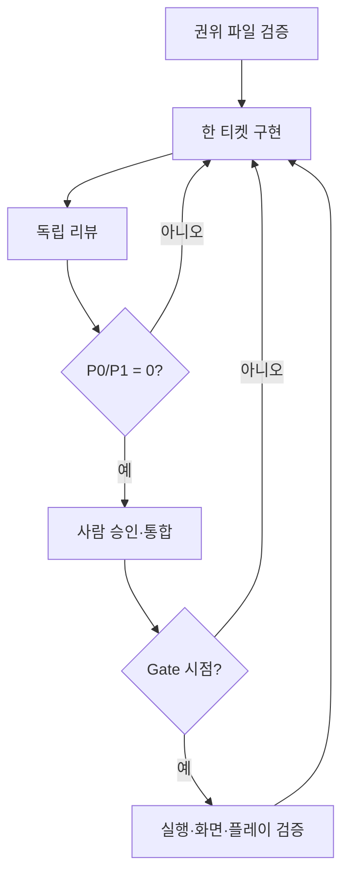

# BORROWED PIXELS v2.1

## Windows + Codex 구현 스타터 가이드

- 문서 역할: 처음 저장소를 만드는 순간부터 공모전 RC를 검사할 때까지의 실행 절차
- 대상 독자: 게임 엔진 없이 C++ 프로젝트를 처음부터 AI 세션과 함께 운영하려는 1인 개발자
- 기준 날짜: 2026-08-27 KST
- 제출 마감: 2026-09-04
- 하드 상한: 압축을 푼 제출 폴더 전체 합계 `1,474,560B`
- 내부 RC 상한: `1,350,000B`

> 이 문서는 편의용 운영 안내서이며 게임 규칙의 권위 문서가 아니다. 숫자·좌표·문구·상태·질량 규칙이 충돌하면 반드시 `BORROWED_PIXELS_AUTHORITY_v2.1.md`가 지정한 원본을 따른다. 이 문서를 이유로 게임 규칙을 바꾸지 않는다.

---

# 0. 먼저 결론

현재 패키지는 **AI가 디자인을 새로 발명하지 않고 첫 구현을 시작할 수 있는 상태**다. 다음 단계는 아이디어 추가가 아니라 `T00` 저장소 부트스트랩이다.

다만 다음 세 가지는 문서만으로 완료 판정할 수 없다.

1. 실제 Windows MSVC 빌드가 바이트 상한을 지키는가.
2. 320×180 화면에서 전투와 한국어가 실제로 읽히는가.
3. 처음 보는 사람이 철학과 선택의 비용을 플레이만으로 이해하는가.

따라서 구현은 다음 순환으로 진행한다.



한 세션에 “게임 전체를 만들어 줘”라고 지시하지 않는다. 각 세션은 한 티켓만 구현하고 `READY_FOR_REVIEW`에서 멈춘다.

---

# 1. 준비해야 할 Windows 환경

## 1.1 필수 설치

Windows 10/11 x64 PC에 다음을 준비한다.

1. **Visual Studio 2022 Community 또는 Build Tools**
   - 워크로드: `Desktop development with C++`
   - 구성 요소: MSVC x64/x86 빌드 도구, Windows 10 또는 11 SDK, CMake tools for Windows
2. **Git for Windows**
3. **CMake**
4. **Visual Studio Code + Codex** 또는 사용 중인 Codex 작업 환경
5. 선택: PowerShell 7. Windows PowerShell 5.1만 있어도 빌드 스크립트는 동작하게 만든다.

공모전 최종 증거는 MinGW·Clang·Wine 빌드가 아니라 **MSVC x64 contest build**에서 얻는다.

## 1.2 설치 확인

시작 메뉴에서 `Developer PowerShell for VS 2022` 또는 `x64 Native Tools Command Prompt for VS 2022`를 연다. PowerShell이라면 다음을 한 줄씩 실행한다.

```powershell
where.exe cl
where.exe cmake
where.exe git
cl
cmake --version
git --version
```

통과 기준:

- `cl.exe`가 x64 MSVC 경로에서 발견된다.
- CMake와 Git이 버전을 출력한다.
- 일반 PowerShell에서 `cl`을 찾지 못하더라도 Developer PowerShell에서는 찾아야 한다.

설치가 안 된 상태에서 구현 세션을 시작하지 않는다. AI가 “Windows에서 확인했다”고 추정 보고하는 것도 인정하지 않는다.

---

# 2. v2.1 입력 파일을 올바른 위치에 모으기

새 프로젝트 폴더의 `docs/authority/`에는 다음 권위·검토 파일만 넣는다.

```text
BORROWED_PIXELS_AUTHORITY_v2.1.md
BORROWED_PIXELS_FINAL_PRODUCTION_SPEC_v2.1.md
BORROWED_PIXELS_RUNTIME_CONTRACT_v2.1.json
BORROWED_PIXELS_FONT_GLYPHS_v2.1.json
BORROWED_PIXELS_AGENT_RUNBOOK_v2.1.md
BORROWED_PIXELS_UI_REFERENCE_ATLAS_v2.1.svg
BORROWED_PIXELS_UI_REFERENCE_ATLAS_v2.1.png
```

이 비권위 안내서는 별도로 둔다.

```text
docs/guides/BORROWED_PIXELS_IMPLEMENTATION_STARTER_GUIDE_v2.1.md
```

구 v1.0·v2.0 문서는 구현 세션에 첨부하지 않는다. 특히 production spec 안에 역사적으로 남은 `v2.0 시작문`을 복사하지 말고, 항상 `AGENT_RUNBOOK_v2.1`의 프롬프트를 쓴다.

권위 순위:

1. runtime contract JSON — 정수, 좌표, enum, 상태, 전장 데이터
2. font glyph JSON — 글리프와 한글 조합 계약
3. final production spec — 의미, 문구, 서사, 엔딩, 인수 조건
4. agent runbook — 티켓, 파일 소유권, 세션 절차
5. UI atlas — 화면 구조 비교
6. 이 starter guide — 사용 편의를 위한 절차 설명

## 2.1 해시 확인

프로젝트 루트에서 다음처럼 실제 파일 해시를 확인한다.

```powershell
Get-FileHash .\docs\authority\BORROWED_PIXELS_RUNTIME_CONTRACT_v2.1.json -Algorithm SHA256
Get-FileHash .\docs\authority\BORROWED_PIXELS_FONT_GLYPHS_v2.1.json -Algorithm SHA256
Get-FileHash .\docs\authority\BORROWED_PIXELS_FINAL_PRODUCTION_SPEC_v2.1.md -Algorithm SHA256
Get-FileHash .\docs\authority\BORROWED_PIXELS_AGENT_RUNBOOK_v2.1.md -Algorithm SHA256
Get-FileHash .\docs\authority\BORROWED_PIXELS_UI_REFERENCE_ATLAS_v2.1.svg -Algorithm SHA256
```

출력값이 authority manifest와 다르면 파일을 고치지 말고 올바른 원본을 다시 복사한다.

---

# 3. 저장소를 처음 만드는 방법

## 3.1 현재 저장소 위치

이 프로젝트의 실제 저장소 루트는 다음 경로로 고정한다.

```text
C:\Users\sdjsd\Desktop\BORROWED_PIXELS
```

문서 다운로드 폴더나 여러 프로젝트가 섞인 상위 폴더에서 `git init`하지 않는다. 오직 이 게임 전용 폴더에서 초기화한다.

## 3.2 최초 명령

```powershell
Set-Location C:\Users\sdjsd\Desktop\BORROWED_PIXELS
git init
git branch -M integration/rc-2026-09-03
```

폴더는 이미 만들어져 있으므로 `New-Item`으로 다시 만들지 않는다. 위 `Set-Location` 뒤에 PowerShell 프롬프트가 `PS C:\Users\sdjsd\Desktop\BORROWED_PIXELS>`로 바뀌었는지 확인한다.

권위 파일을 `docs/authority/`에 복사한 뒤:

```powershell
git add docs/authority docs/guides
git commit -m "docs: freeze BORROWED PIXELS v2.1 authority"
```

아직 코드 폴더를 손으로 많이 만들 필요는 없다. `T00`이 권위 문서의 트리를 기준으로 생성한다.

## 3.3 최종 저장소 형태

```text
BORROWED_PIXELS/
├─ CMakeLists.txt
├─ CMakePresets.json
├─ docs/
│  ├─ authority/
│  ├─ evidence/TXX/
│  ├─ handoffs/TXX/
│  ├─ ui/approved/
│  ├─ STATUS.md
│  ├─ OWNERSHIP.md
│  ├─ PROVENANCE.md
│  └─ RIGHTS_LOG.md
├─ src/
├─ tests/
├─ tools/
└─ dist/contest/
```

`dist/contest/`는 결과물 전용이다. 원본 JSON, SVG, PNG, PDB, MAP, 테스트, 설계 문서를 넣지 않는다.

---

# 4. AI 세션을 어떻게 나눌 것인가

## 4.1 역할 네 종류

| 세션 | 하는 일 | 직접 코드 수정 | 최종 승인 |
|---|---|---:|---:|
| INTEGRATOR | 상태 확인, 후보 검증, 순서 관리, 통합 준비 | integration 범위만 | 아니오 |
| IMPLEMENTER Txx | 해당 티켓 allowlist만 구현 | 예 | 아니오 |
| REVIEWER Txx | 후보 SHA를 읽고 재현·결함 보고 | 아니오 | 아니오 |
| HUMAN DIRECTOR | 실행, 화면 판단, 플레이테스트, merge 승인 | 필요 시 | 예 |

Codex 세션의 말만으로 티켓을 통과시키지 않는다. 구현 세션과 리뷰 세션을 분리하고, 후보 SHA가 바뀌면 이전 리뷰는 무효다.

## 4.2 병렬 작업 제한

- 세션을 여러 개 열어도 **코드 writer는 기본적으로 한 명씩** 진행한다.
- 명세상 안전하게 동시 작성할 수 있는 것은 `T08A`와 `T08B`뿐이다.
- 이 둘도 `bp_act2.cpp`와 `bp_act3.cpp` 밖의 공용 헤더를 수정하지 않는다.
- 리뷰, 문서 확인, 테스트 로그 검토는 구현과 병렬로 할 수 있다.
- 같은 working directory를 두 writer가 동시에 쓰게 하지 않는다.

## 4.3 추천 Git worktree

기준 저장소는 `C:\Users\sdjsd\Desktop\BORROWED_PIXELS`다. Worktree는 저장소 내부가 아니라 Desktop의 형제 폴더로 만든다.

```powershell
Set-Location C:\Users\sdjsd\Desktop\BORROWED_PIXELS
git worktree add C:\Users\sdjsd\Desktop\BORROWED_PIXELS_T00 -b ticket/T00-bootstrap integration/rc-2026-09-03
```

Codex T00 구현 세션에는 `C:\Users\sdjsd\Desktop\BORROWED_PIXELS_T00`만 연다. 리뷰 세션은 같은 후보를 읽되 수정하지 않게 지시한다. 이후 티켓도 `BORROWED_PIXELS_T01`, `BORROWED_PIXELS_T02`처럼 같은 규칙으로 만든다.

티켓 승인 뒤 통합은 사람 또는 integrator가 원본 저장소에서 준비한다.

```powershell
Set-Location C:\Users\sdjsd\Desktop\BORROWED_PIXELS
git status --short
git merge --ff-only candidate/T00-final
```

`--ff-only`가 실패하면 억지로 merge하지 말고 base가 왜 갈라졌는지 확인한다.

Worktree를 쓸 수 없는 환경이면 같은 폴더에서 writer를 한 번에 하나만 실행한다.

---

# 5. 모든 티켓에서 반복할 정확한 절차

## 5.1 시작 전

1. integration의 최신 accepted SHA를 확인한다.
2. clean worktree에서 새 ticket branch를 만든다.
3. 권위 파일 해시를 확인한다.
4. 현재 debug/test/contest 빌드와 dist 측정을 먼저 실행한다.
5. 티켓 allowlist와 인수 조건을 세션이 먼저 말하게 한다.
6. 필요한 값이 권위 문서에 없으면 구현 전에 `SPEC_BLOCKER`로 멈춘다.

## 5.2 구현 중

- allowlist 밖 파일이 필요해지면 일단 멈춘다.
- “더 예뻐 보이게”, “더 재밌게”, “일반적인 값으로” 변경하지 않는다.
- 런타임 JSON parser를 넣지 않는다. T00/T02에서 JSON을 C++ 상수로 생성하거나 검증용으로만 사용한다.
- 외부 이미지·폰트·음원·라이브러리·네트워크·런타임 AI를 추가하지 않는다.
- simulation 결과에 float, system time, pointer order, unordered iteration을 쓰지 않는다.
- 매 중요한 transaction 후 두 원장이 각각 1,440인지 검증한다.

## 5.3 구현 종료

구현 세션은 다음을 모두 남긴다.

```text
TICKET:
BASE SHA:
CANDIDATE SHA:
AUTHORITY HASHES:
CHANGED PATHS:
ACCEPTANCE MAP:
COMMANDS RUN:
TEST RESULTS:
DIST BYTES / DELTA:
DETERMINISM RESULT:
RIGHTS / ASSET RESULT:
KNOWN RISKS:
STATUS: READY_FOR_REVIEW | BLOCKED
```

“잘 동작함”, “테스트 통과”만 쓰고 실제 명령·로그·SHA가 없으면 리뷰 실패다.

## 5.4 독립 리뷰

리뷰 세션은 수정하지 않고 P0/P1/P2를 보고한다.

- P0: 데이터 손실, 원장 불변식 파괴, 실행 불능, 하드 상한 위반
- P1: 명세 불일치, 결정론 위반, 테스트 누락, UI 계약 위반, 접근 불가 콘텐츠
- P2: 유지보수성, 로그 개선, 비차단 정리

P0/P1이 하나라도 있으면 구현 세션에 최소 수정만 다시 요청한다. 후보 SHA가 바뀌면 리뷰를 다시 한다.

## 5.5 사람 승인

자동 검사 뒤에도 사람이 직접:

1. EXE를 실행한다.
2. 해당 티켓의 수동 인수 조건을 확인한다.
3. Gate 3/4/5에서는 캡처 또는 관찰 기록을 남긴다.
4. 승인할 때만 integration에 반영한다.

---

# 6. 빌드 인터페이스를 T00에서 고정하기

T00에게 다음 명령 인터페이스를 만들게 한다. 이후 모든 세션은 같은 명령만 쓴다.

```powershell
cmake --preset windows-msvc
cmake --build --preset debug
cmake --build --preset test
ctest --preset all --output-on-failure
cmake --build --preset contest
powershell -ExecutionPolicy Bypass -File .\tools\measure_dist.ps1 -Path .\dist\contest -InternalCap 1350000 -HardCap 1474560
```

필수 CMake 대상:

| 대상 | 용도 | 결과 |
|---|---|---|
| `bp_debug` | 심볼·assert·원장 로그 | 개발용 EXE |
| `bp_test` | headless property/replay/capture test | console test EXE |
| `bp_contest` | 공모전 제출 | `dist/contest/BorrowedPixels.exe` |
| `bp_steam` | 공모전 뒤 확장 | 초기에는 빌드하지 않아도 됨 |

contest compile/link 플래그는 production spec 33.2를 그대로 따른다. T00이 임의로 `/NODEFAULTLIB`나 커스텀 CRT entry를 넣지 않는다.

## 6.1 dist 측정의 정의

측정값은 ZIP 크기가 아니다. `dist/contest/` 아래 regular file의 `Length` 합이다.

```powershell
(Get-ChildItem .\dist\contest -File -Recurse | Measure-Object -Property Length -Sum).Sum
```

판정:

- `≤1,350,000B`: 내부 RC PASS 가능
- `1,350,001~1,474,560B`: 공모전 하드 상한 안이지만 RC 차단
- `>1,474,560B`: 즉시 실패

8KB 이상 증가하면 MAP/symbol 기반 이유를 기록한다. 25KB 이상 증가는 사람의 byte-budget 재승인 전 통합하지 않는다.

## 6.2 의존 DLL 확인

Developer PowerShell에서:

```powershell
dumpbin /dependents .\dist\contest\BorrowedPixels.exe
```

허용 대상은 production spec 33.2의 OS DLL뿐이다. XInput은 동적 로드하며 없어도 키보드·마우스로 실행되어야 한다.

---

# 7. 티켓별 실제 작업 순서

아래 순서를 바꾸지 않는다.

| 순서 | 티켓 | 세션이 실체화할 것 | 통과 증거 |
|---:|---|---|---|
| 1 | T00 | 저장소, CMake, presets, 권리대장, dist 측정 | clean 3-target build, exact byte log |
| 2 | T01 | Win32 창, 320×180 backbuffer, 입력, timing, silent waveOut | shell EXE, focus pause, ≤450KB |
| 3 | T02 | 타입, Physical/Claim ledger, transaction, SaveV2 | 19,683 조합, rollback, 96B golden |
| 4 | API GATE | T01/T02 공용 header·handle·InputFrame 동결 | reviewer P0/P1 0, accepted SHA |
| 5 | T03 | primitive renderer, font, UI shell | rect/palette/glyph/capture tests |
| 6 | T04 | fixed tick, 이동, 충돌, dash | replay hash·boundary test |
| 7 | T05 | Charge, Projectile, 피격, Core | 질량 보존·swept collision |
| 8 | T06 | Neutral, reclaim, HUD loan | slot saturation·7×3 HUD states |
| 9 | T07 | 만남 프레임워크, 서막, PATCH, PAIR, VESSEL | Gate 4 실제 완주 |
| 10 | T08A | KEEPER, ADAPTER, FRAME | 각 결과 경로·전장 exact |
| 10 | T08B | INDEX, WITNESS, CURRENT | 각 결과 경로·우선순위 exact |
| 11 | T09 | PRECEDENT 81 profile | 81 profile × seeds softlock 0 |
| 12 | T10 | 진행, 결산, 5엔딩, AUDIT TRACE | 엔딩 조건·continue·save |
| 13 | T11 | 합성 오디오, 옵션, 접근성 | voice overflow·hash 독립 |
| 14 | T12 | KO/EN copy, 전체 glyph, credits | 잘림·누락 0, provenance |
| 15 | T13 | 밸런스와 플레이테스트 amendment | Gate 5 정량 기록 |
| 16 | T14 | RC, 3PC, rights, contest folder | Gate 6와 ≤1,350,000B |

## 7.1 티켓별 파일 경계

정확한 allowlist는 runbook 5장을 복사해 `docs/handoffs/TXX/INPUT.md`에 넣는다. 핵심 경계는 다음과 같다.

| 티켓 | 허용 영역 |
|---|---|
| T00 | 루트 빌드 파일, `tools/`, `docs/` 운영 파일 |
| T01 | `bp_win32.cpp`, `bp_platform.h` |
| T02 | types, physical/claim ledger, save, 관련 tests |
| T03 | render, font, UI tests |
| T04 | game, input, math, 관련 tests |
| T05 | combat와 관련 tests |
| T06 | reclaim, hud_loan, 관련 tests |
| T07 | encounter, act1, content의 승인 범위 |
| T08A | `bp_act2.cpp`와 해당 test만 |
| T08B | `bp_act3.cpp`와 해당 test만 |
| T09 | precedent와 해당 test |
| T10 | narrative, save의 승인 범위 |
| T11 | audio, option UI layer의 승인 범위 |
| T12 | content/font/narrative copy의 승인 범위 |
| T13 | 승인된 v2.2 amendment가 가리키는 값만 |
| T14 | dist, evidence, release tooling만 |

공용 헤더 변경이 필요하면 구현자가 조용히 수정하지 않는다. 제안 signature와 필요한 이유를 `SPEC_BLOCKER`로 남기고 API gate를 다시 연다.

---

# 8. 마감까지의 공격 일정

현재가 2026-08-27 KST라는 전제의 매우 공격적인 일정이다. AI 세션이 빨라도 Windows 실행과 사람 플레이 검증 시간은 줄일 수 없다.

| KST 날짜 | 목표 | 그날 끝나야 하는 상태 |
|---|---|---|
| 8/27 | T00→T01→T02 | Gate 1·2 후보, API freeze |
| 8/28 | T03→T04→T05→T06 | 전투 시스템과 UI shell 통합 |
| 8/29 | T07 | 1막 수직 슬라이스, Gate 4 플레이 |
| 8/30 | T08A/T08B 병렬 | 여섯 소규모 점유자 완주 |
| 8/31 | T09→T10 | PRECEDENT와 5엔딩 접근 가능 |
| 9/1 | T11→T12 | 오디오·옵션·KO/EN·credits Alpha |
| 9/2 | T13 | 외부 플레이테스트, 승인된 수정만 반영 |
| 9/3 | T14 | 세 PC·권리·크기·업로드용 RC 완료 |
| 9/4 | 복구 버퍼 | 새 기능 금지, 업로드/주최자 문의 대응만 |

중단 기준:

- 8/27에 빈 shell이 450KB를 넘으면 콘텐츠를 시작하지 말고 크기 원인을 분석한다.
- 8/29 Gate 4가 실패하면 T08을 시작하지 않고 수직 슬라이스를 고친다.
- 일정이 밀려도 AI가 핵심 만남·원장·엔딩을 자의적으로 삭제하지 않는다.
- 먼저 자를 수 있는 항목은 production spec 18장의 비핵심 항목뿐이다.
- 9/3 밤에 기능을 추가하지 않는다. 마지막 날은 RC 재현과 업로드를 위한 날이다.

---

# 9. 첫 세션에 그대로 붙일 T00 프롬프트

아래 블록을 새 Codex 세션에 붙이고, v2.1 입력 파일 8개가 올바른 `docs/` 하위 경로에 들어 있는 프로젝트 폴더를 열어 준다.

```text
You are BP-T00, the bootstrap implementer for BORROWED PIXELS v2.1.

Read these files completely before editing:
- docs/authority/BORROWED_PIXELS_AUTHORITY_v2.1.md
- docs/authority/BORROWED_PIXELS_FINAL_PRODUCTION_SPEC_v2.1.md
- docs/authority/BORROWED_PIXELS_RUNTIME_CONTRACT_v2.1.json
- docs/authority/BORROWED_PIXELS_FONT_GLYPHS_v2.1.json
- docs/authority/BORROWED_PIXELS_AGENT_RUNBOOK_v2.1.md
- docs/guides/BORROWED_PIXELS_IMPLEMENTATION_STARTER_GUIDE_v2.1.md

Verify every authoritative SHA-256 against the manifest. Do not use any v1.0 or v2.0 document.

Ticket: T00 only.
Goal:
1. Create the repository skeleton required by the v2.1 runbook.
2. Create CMakeLists.txt and CMakePresets.json exposing:
   - cmake --preset windows-msvc
   - cmake --build --preset debug
   - cmake --build --preset test
   - ctest --preset all --output-on-failure
   - cmake --build --preset contest
3. Create bp_debug, bp_test, bp_contest target skeletons without an engine or third-party runtime.
4. Create tools/measure_dist.ps1 with parameters Path, InternalCap, HardCap.
5. Create tools/verify_authority.ps1.
6. Create docs/STATUS.md, docs/OWNERSHIP.md, docs/PROVENANCE.md, docs/RIGHTS_LOG.md and docs/handoffs/T00/OUTPUT.md.
7. Ensure contest output is only written under dist/contest.

Hard constraints:
- Windows x64 standalone C++20/Win32.
- Extracted folder hard cap 1,474,560 bytes; internal cap 1,350,000.
- MSVC contest flags must match production spec 33.2.
- Do not add /NODEFAULTLIB, a custom CRT entry, external libraries, downloaded assets, runtime JSON parsing, network, browser, or runtime AI.
- Authority files are read-only.
- Do not implement T01 window/game behavior or any game rule.

Before editing, report:
- authority hashes;
- git branch, HEAD, and working-tree state;
- intended changed-path allowlist;
- acceptance criteria mapped to commands.

After editing:
- run every build/test command available on this Windows environment;
- run exact dist measurement;
- report changed paths, full commands, exit results, exact bytes, and risks;
- commit to ticket/T00-bootstrap;
- write the required OUTPUT.md;
- stop at READY_FOR_REVIEW, never merge and never claim ACCEPTED.

If Windows/MSVC cannot actually be run in this session, mark those checks NOT_RUN. Do not infer PASS.
If any required value conflicts or is absent, stop with SPEC_BLOCKER before editing.
```

T00 결과로 반드시 받아야 할 것:

- candidate commit SHA
- 변경 파일 목록
- `cmake`/`ctest` 전체 로그 경로
- 정확한 `dist/contest` bytes
- 실행하지 못한 Windows 검증 목록
- `READY_FOR_REVIEW`, 그 이상이 아닌 상태

---

# 10. T01 이후 구현 세션 공통 프롬프트

각 티켓의 `INPUT.md`에 runbook 표의 목표·파일·선행·인수 조건을 넣고 아래 `[ ]`만 바꾼다.

```text
You are BP-[TICKET], one bounded implementation session for BORROWED PIXELS v2.1.

Read every file in full before editing:
1. docs/authority/BORROWED_PIXELS_AUTHORITY_v2.1.md
2. docs/authority/BORROWED_PIXELS_FINAL_PRODUCTION_SPEC_v2.1.md
3. docs/authority/BORROWED_PIXELS_RUNTIME_CONTRACT_v2.1.json
4. docs/authority/BORROWED_PIXELS_FONT_GLYPHS_v2.1.json
5. docs/authority/BORROWED_PIXELS_AGENT_RUNBOOK_v2.1.md
6. docs/handoffs/[TICKET]/INPUT.md
[For UI work only: docs/authority/BORROWED_PIXELS_UI_REFERENCE_ATLAS_v2.1.svg]

Verify the authority hashes. Older v1.0/v2.0 material is non-authoritative.

Base accepted SHA: [BASE_SHA]
Ticket: [TICKET]
Allowed paths only: [ALLOWLIST]
Goal: [ONE-SENTENCE GOAL]
Acceptance criteria: [COPY VERBATIM FROM RUNBOOK/SPEC]

Hard constraints:
- Windows x64 standalone C++20/Win32.
- dist hard cap 1,474,560 bytes; internal RC cap 1,350,000 bytes.
- PhysicalLedgerTotal()==1440 and ClaimLedgerTotal()==1440.
- No engine, third-party runtime, external runtime asset, network, browser, or runtime AI.
- Deterministic integer/fixed-point simulation and fixed-capacity storage.
- Do not invent or tune coordinates, copy, states, timing, weights, encounter rules, or save fields.
- Do not edit outside the allowlist.

Before editing:
1. Report authority hashes, branch/HEAD, clean state, and allowlist.
2. Run current debug/test/contest builds and exact dist measurement.
3. Map every acceptance criterion to an automated test or named manual capture.
4. Stop with SPEC_BLOCKER if a value is missing, contradictory, or requires an out-of-scope API change.

After editing:
1. Build debug, test, and contest.
2. Run ticket tests, both ledger validators, replay hash, and exact dist measurement.
3. Report every command and exact result; never summarize an unrun check as PASS.
4. Write docs/handoffs/[TICKET]/OUTPUT.md.
5. Commit and report candidate SHA.
6. End at READY_FOR_REVIEW. Do not merge or declare ACCEPTED.
```

## 10.1 티켓별 한 문장 목표

| 티켓 | `[ONE-SENTENCE GOAL]`에 넣을 문장 |
|---|---|
| T01 | Implement only the Win32 platform shell, deterministic tick source, input edge collection, 320x180 integer-scaled backbuffer, focus pause, and silent waveOut fallback. |
| T02 | Implement the frozen core types, both 1,440 ledgers, exact-or-zero transactions, SaveV2 field serialization, and exhaustive ledger properties. |
| T03 | Implement only the primitive renderer, frozen palette/rect/z-order UI shell, Latin bitmap font, Korean composition, and golden capture tests. |
| T04 | Implement fixed-tick GameState movement, input arbitration, Q8.8 math, collision boundaries, and dash with deterministic replay hashes. |
| T05 | Implement charge, projectile lifecycle, swept collision priority, shell/core/cover hits, and mass-conserving failure paths. |
| T06 | Implement Neutral dynamics/merge/reclaim and all HUD-loan channel, maturity, due, repayment, cancellation, and capture states. |
| T07 | Implement the encounter framework and playable TITLE→BORROW→PATCH→PAIR→VESSEL→SETTLEMENT→ENOUGH/CONTINUE vertical slice. |
| T08A | Implement only KEEPER, ADAPTER, and FRAME using the frozen T07 interface and bp_act2.cpp ownership boundary. |
| T08B | Implement only INDEX, WITNESS, and CURRENT using the frozen T07 interface and bp_act3.cpp ownership boundary. |
| T09 | Implement PRECEDENT policy derivation and all 81 profiles without softlocks or hidden mass. |
| T10 | Implement progression, settlement commits/previews, five endings, continue rules, AUDIT TRACE, and SaveV2 progression. |
| T11 | Implement synthesized audio, options, accessibility, and failure fallbacks without affecting GameStateHash. |
| T12 | Integrate frozen KO/EN copy, validate every glyph and rect, and complete credits/provenance without runtime external assets. |
| T13 | Apply only human-approved balance amendments and produce Gate 5 playtest evidence; do not tune by intuition. |
| T14 | Produce and verify the reproducible MSVC x64 contest RC, three-PC evidence, rights log, dependencies, and exact folder bytes. |

---

# 11. 리뷰 세션에 그대로 붙일 프롬프트

```text
Review candidate [CANDIDATE_SHA] for BORROWED PIXELS v2.1 ticket [TICKET].
This is a read-only review. Do not edit, commit, merge, or retune.

Read the v2.1 authority manifest, production spec, runtime contract, font contract, agent runbook, ticket INPUT, and implementer OUTPUT in full.

Reproduce and verify:
- candidate SHA and all authority hashes;
- clean base and changed paths inside the ticket allowlist;
- every acceptance criterion and the exact command/log evidence;
- Physical and Claim ledgers remain exactly 1,440 on success and failure;
- preview never commits and save never serializes preview;
- no float, system time, pointer address, unstable order, heap-after-BOOT, hidden runtime asset, network, browser, or third-party dependency;
- array capacity, handle generation, overflow, corrupted-save, focus-loss, audio-failure, and slot-saturation paths relevant to this ticket;
- exact contest dist bytes and delta;
- every coordinate, string, state, timing, weight, and save offset touched by the ticket matches v2.1.

Return:
1. reproduced commands and results;
2. findings as P0/P1/P2, each with file, symbol, reproduction, violated clause, and smallest compliant fix;
3. unverified criteria explicitly marked NOT_VERIFIED;
4. final status REVIEW_BLOCKED or READY_FOR_HUMAN_GATE.

P0/P1 must be zero for READY_FOR_HUMAN_GATE. Never repair the code yourself.
```

---

# 12. Integrator 세션 프롬프트

Integrator는 기능을 고치지 않는다. 후보가 올바른지 확인하고 사람이 승인할 merge 명령만 준비한다.

```text
Act as BORROWED PIXELS v2.1 INTEGRATOR for ticket [TICKET].
Do not implement features and do not merge without explicit human approval.

Inputs:
- integration base SHA: [BASE_SHA]
- candidate SHA: [CANDIDATE_SHA]
- implementer OUTPUT
- independent reviewer report

Verify authority hashes, branch ancestry, clean state, allowlist, P0/P1=0, all required logs, exact byte delta, and current gate prerequisites.
Re-run the full debug/test/contest command set and dist measurement on Windows MSVC when available.

Return only:
- ACCEPTANCE_CHECKLIST with PASS/FAIL/NOT_RUN;
- exact remaining human checks;
- proposed --ff-only integration command if eligible;
- next ticket INPUT draft with frozen base SHA and allowlist.

Do not edit implementation code. Do not merge, tag, or call the ticket ACCEPTED until the human confirms the manual checks.
```

---

# 13. 웹 GPT를 UI에 쓰는 정확한 방식

웹 GPT는 런타임 디자인 결정권자가 아니라 **픽셀 계약 감사자와 4배 검토용 목업 도구**로만 쓴다.

## 13.1 매번 제공할 입력

1. production spec 24~26장
2. runtime contract의 `palette`, `regions`, `screens`, `motion`
3. 승인 UI atlas SVG 또는 PNG
4. 현재 게임의 320×180 무보간 캡처
5. 검사할 화면 이름과 언어(KO/EN)

## 13.2 그대로 쓸 UI 감사 프롬프트

```text
You are a visual contract auditor for BORROWED PIXELS v2.1, not a redesign agent.

The attached production-spec excerpts, runtime JSON fields, and approved atlas are authoritative. The attached 320x180 capture is the implementation under review.

Check only:
1. exact region coordinates, dimensions, z-order, 1px/2px line rules;
2. palette membership and color-independent state readability;
3. KO/EN glyph clipping, forced line breaks, baselines, and information hierarchy;
4. nearest-neighbor scaling and unintended smoothing;
5. whether the result accidentally resembles an OS error screen, terminal skin, rounded-card web UI, or a recognizable existing game's overall presentation.

Return:
- a table of PASS/FAIL/UNVERIFIABLE by contract item;
- for every failure, expected rect/value, observed rect/value, and pixel coordinates;
- a 4x review mockup that preserves every authoritative coordinate and color;
- optional improvements only under a clearly labeled PROPOSAL section.

Do not invent new buttons, strings, icons, panels, animation, rules, colors, coordinates, fonts, or assets. Do not imitate any named artist, studio, franchise, or game. The mockup is review evidence only and will not be shipped as a runtime asset.
```

## 13.3 사람이 확인할 UI 항목

- PLAYER, 상대, Neutral을 1초 안에 구분할 수 있는가.
- VITAL/VECTOR/IMPULSE 중 사라진 기능을 색 없이 알 수 있는가.
- TITLE의 64 TILE이 몸으로 옮겨지는 인과가 보이는가.
- 한국어가 작은 시스템 글씨가 아니라 의도한 조형으로 보이는가.
- 탄도·플레이어·Core 위를 대사가 가리지 않는가.
- 카드 UI, 둥근 모서리, glow, gradient, blur가 생기지 않았는가.

웹 GPT가 제안한 변경은 자동 반영하지 않는다. 필요하면 사람이 `PROPOSAL`을 검토해 v2.2 amendment로 승인한 뒤 해당 티켓에 넣는다.

---

# 14. Gate별 사람이 실제로 해야 할 테스트

## Gate 0 — 권위

- [ ] v1/v2.0 파일이 구현 context에 없다.
- [ ] authority 해시가 manifest와 일치한다.
- [ ] 모든 티켓 INPUT에 base SHA와 allowlist가 있다.

## Gate 1 — 기반

- [ ] Windows에서 창이 실제로 열린다.
- [ ] 내부 320×180이 정수 nearest-neighbor로 확대된다.
- [ ] 창 최소 크기와 letterbox가 맞다.
- [ ] focus를 잃으면 pause되고 복귀 후 입력 edge가 폭주하지 않는다.
- [ ] waveOut 실패 시 무음으로 계속된다.
- [ ] contest dist가 450,000B 이하이다.

## Gate 2 — 원장

- [ ] Physical/Claim이 매 tick 각각 1,440이다.
- [ ] 19,683 선택 조합이 모두 통과한다.
- [ ] 실패 transaction 뒤 메모리가 byte-identical이다.
- [ ] SaveV2가 정확히 96B이며 손상 저장이 안전하게 거부된다.

## Gate 3 — UI freeze

- [ ] TITLE, GLOBAL_LEDGER, COMBAT, SETTLEMENT, POLICY_AUDIT, 5 ENDING 캡처가 있다.
- [ ] atlas 대비 rect가 일치한다.
- [ ] 팔레트 밖 pixel이 0이다.
- [ ] KO/EN 잘림과 glyph 누락이 0이다.
- [ ] HUD 7상태×3모듈 캡처가 있다.
- [ ] 색각에 의존하지 않고 기능 상태를 읽을 수 있다.

## Gate 4 — 1막 수직 슬라이스

처음 보는 5명에게 설명 없이 플레이시킨다. 다음 질문은 플레이 뒤에만 묻는다.

1. “총을 쏘면 무엇이 줄고, 빗나간 것은 어떻게 되나요?”
2. “HUD 기능을 끈 것이 단순한 옵션인가요, 세계 안의 자원 이동인가요?”
3. “VESSEL 이후 다음 싸움은 생존에 꼭 필요한가요?”

통과:

- [ ] 5명 중 4명 이상이 몸→탄→Neutral/회수 관계를 설명한다.
- [ ] 5명 중 4명 이상이 HUD를 실제 질량 대출로 설명한다.
- [ ] 5명 중 4명 이상이 다음 전투를 생존 이후의 선택으로 설명한다.
- [ ] TITLE→ENOUGH/CONTINUE가 실제로 완주된다.
- [ ] crash, ledger error, softlock가 0이다.
- [ ] contest dist가 950,000B 이하이다.

실패하면 대사를 늘리는 것이 첫 해결책이 아니다. 어느 행동-결과 연결이 보이지 않았는지 캡처와 관찰을 먼저 기록한다.

## Gate 5 — 철학·재미

8명 기록표를 만들어 만남 직후 다음만 묻는다.

- “방금 상대는 무엇을 지키려 했나요?”
- “당신 선택으로 누가 무엇을 얻고 잃었나요?”
- “PRECEDENT가 왜 그런 방식으로 싸웠다고 생각하나요?”
- 엔딩 뒤: “이 결말의 장점 하나와 비용 하나는 무엇인가요?”

통과:

- [ ] 첫 회차 중앙값 38~52분.
- [ ] 각 만남에서 8명 중 6명 이상이 딜레마를 한 문장으로 설명한다.
- [ ] 한 선택에 8명 중 7명 이상이 몰리지 않는다. 몰리면 비용/표현을 검토한다.
- [ ] PRECEDENT를 8명 중 6명 이상이 “내 선택이 규칙으로 돌아옴”으로 이해한다.
- [ ] 실패 원인의 80% 이상을 플레이어가 식별한다.
- [ ] 각 엔딩의 장점과 비용을 8명 중 6명 이상이 말한다.
- [ ] ENOUGH를 단순 포기/게임 오버로만 읽은 사람이 3명 미만이다.
- [ ] ONE을 단순 최강/진엔딩으로 읽은 사람이 절반 미만이다.

## Gate 6 — RC

- [ ] Windows 10과 Windows 11을 포함한 서로 다른 3대 PC에서 실행한다.
- [ ] 관리자 권한, 설치, 네트워크, 브라우저가 필요 없다.
- [ ] 외부 VC runtime 설치 없이 실행된다.
- [ ] `dumpbin /dependents` 결과가 허용 목록 안이다.
- [ ] `dist/contest`에는 EXE, README, 필요할 때만 LICENSES가 있다.
- [ ] 합계가 1,350,000B 이하이고 로그에 정확한 값이 있다.
- [ ] 최종 SHA-256, PC 환경, 실행 결과, Defender/SmartScreen 결과를 기록했다.
- [ ] 업로드한 파일을 다시 내려받아 압축 해제 후 재측정했다.

---

# 15. 버그나 막힘이 생겼을 때

## 15.1 SPEC_BLOCKER

다음이면 추측 구현하지 않는다.

- 권위 파일끼리 값이 다르다.
- 필요한 좌표·틱·문구·enum이 없다.
- allowlist 밖 공용 API 변경이 필요하다.
- 인수 조건을 현재 구조로 테스트할 수 없다.
- 크기나 독립 실행 조건을 깨야 진행할 수 있다.

```text
SPEC_BLOCKER
Ticket:
Base SHA:
Conflicting or missing clauses:
Why a design/API decision is required:
Smallest proposed amendment:
Affected tests/files/bytes:
No code changed: YES
```

## 15.2 빌드 실패

1. 첫 실제 compiler error부터 해결한다.
2. 다른 티켓 파일을 건드려 우회하지 않는다.
3. 새 library를 설치해 숨기지 않는다.
4. 수정 뒤 debug/test/contest 세 빌드를 다시 실행한다.

## 15.3 원장 실패

1. 실패 seed와 tick을 고정한다.
2. transaction 전후 Physical/Claim 각 행과 slot handle을 dump한다.
3. 최초로 1,440이 깨진 tick만 추적한다.
4. 누락 질량을 임의 계정에 더해 보정하지 않는다.
5. 실패 상태를 저장하지 않는다.

## 15.4 크기 급증

1. 이전 accepted contest bytes와 delta를 확인한다.
2. linker MAP과 `/VERBOSE` 증거로 section/symbol 증가를 찾는다.
3. 외부 asset, 중복 문자열, RTTI, exception, iostream, filesystem, locale, regex가 들어왔는지 본다.
4. safety check를 지우지 않는다.
5. 25KB 이상이면 merge를 멈추고 budget 승인을 받는다.

## 15.5 UI가 읽히지 않음

1. 해당 320×180 원본 capture를 저장한다.
2. atlas와 rect/palette/glyph diff를 먼저 통과시킨다.
3. 잘못 구현된 문제와 명세 자체의 문제를 구분한다.
4. 명세 문제면 구현자가 고치지 말고 인간이 v2.2 amendment를 작성한다.

---

# 16. 사람이 매 세션마다 하는 일 — 7단계 요약

1. 최신 integration SHA에서 새 ticket worktree를 만든다.
2. 올바른 프로젝트 폴더와 v2.1 문서만 세션에 준다.
3. 티켓 프롬프트의 `[BASE_SHA]`, `[ALLOWLIST]`, 목표, 인수 조건을 채워 붙인다.
4. 세션이 `READY_FOR_REVIEW`와 candidate SHA를 낼 때까지 범위 밖 요구를 추가하지 않는다.
5. 새 읽기 전용 reviewer 세션에 SHA와 두 handoff를 준다.
6. P0/P1=0이면 직접 실행·화면·조작을 확인하고 integration을 승인한다.
7. accepted SHA를 다음 티켓 INPUT의 base로 고정한다.

AI에게 “이전 세션이 알아서 했을 것”이라고 가정하게 하지 않는다. SHA, 명령, bytes, 캡처가 없으면 하지 않은 것으로 본다.

---

# 17. 지금 당장 할 일

오늘은 다음 하나만 시작한다.

> **T00 세션을 열고 9장의 프롬프트를 그대로 실행한다.**

T00이 돌아오면 다음 다섯 항목을 확인한다.

1. Windows/MSVC에서 실제로 실행한 명령과 `NOT_RUN` 구분
2. candidate SHA와 clean worktree
3. 세 target과 고정된 CMake preset 이름
4. 정확한 dist bytes
5. authority files 무변경

그 뒤 T00 reviewer를 통과시키고 사람 승인 후에만 T01로 이동한다. 현재 단계에서 캐릭터·엔딩·UI를 더 발명하거나 이미지 에셋을 먼저 만드는 것은 착수 순서가 아니다.

---

# 18. 구현 완료라고 부를 수 있는 순간

다음을 모두 만족할 때만 `IMPLEMENTATION COMPLETE`라고 부른다.

- T00~T14가 accepted SHA로 integration에 반영됨
- 모든 독립 리뷰 P0/P1=0
- Gate 0~6 증거 존재
- 10개 이름 있는 만남과 PRECEDENT 81 profile 접근 가능
- 다섯 엔딩과 ENOUGH continue가 조건대로 동작
- 두 원장이 모든 tick에 각각 1,440
- 3PC Windows 독립 실행
- contest folder `≤1,350,000B`
- 외부 runtime asset/라이브러리/network/browser 의존 0
- 권리 대장과 AI-assisted 인간 승인 기록 완성
- 철학 이해와 플레이 시간 목표 통과

그 전에는 실제 상태에 맞게 `BOOTSTRAP`, `PROTOTYPE`, `VERTICAL SLICE`, `ALPHA`, `RC CANDIDATE`라고 부른다.
